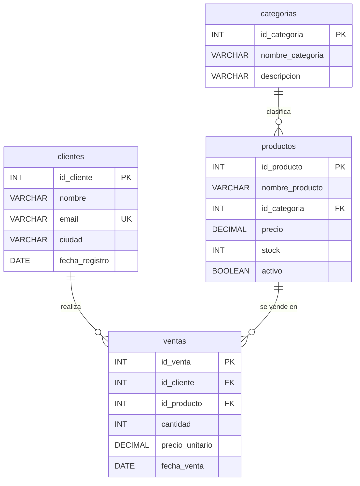

[README.md](https://github.com/user-attachments/files/34861416/README.md)
# RetailPro — Análisis comercial con PostgreSQL

Caso académico de análisis comercial para una empresa distribuidora de tecnología. El proyecto modela y consulta datos de **ventas, clientes, productos y categorías** en PostgreSQL, y se complementa con herramientas de preparación y visualización de datos.

> **Nota:** los elementos marcados como _(pendiente de confirmar)_ no pudieron verificarse a partir del contenido actual del repositorio y deben completarse antes de publicar.

---

## Tabla de contenidos

1. [Descripción y objetivo](#1-descripción-y-objetivo)
2. [Herramientas utilizadas](#2-herramientas-utilizadas)
3. [Modelo de datos](#3-modelo-de-datos)
4. [Scripts y consultas](#4-scripts-y-consultas)
5. [Requisitos](#5-requisitos)
6. [Pasos de ejecución](#6-pasos-de-ejecución)
7. [Alcance, supuestos y limitaciones](#7-alcance-supuestos-y-limitaciones)
8. [Pendientes de confirmar](#8-pendientes-de-confirmar)

---

## 1. Descripción y objetivo

**RetailPro** es un caso académico que simula el análisis comercial de una distribuidora de tecnología. A partir de una base relacional pequeña (ventas, clientes, productos y categorías) se busca:

- Modelar y cargar los datos en PostgreSQL.
- Cruzar las tablas con `JOIN` para obtener una vista enriquecida de las ventas, apta para análisis en Power BI.
- Identificar clientes y productos sin movimientos.
- Calcular indicadores comerciales básicos (cantidad de ventas, unidades, facturación, período).
- Generar hallazgos útiles para un equipo comercial y documentarlos.

## 2. Herramientas utilizadas

| Herramienta | Uso en el proyecto |
|---|---|
| **PostgreSQL / SQL** | Modelado de la base de datos, carga de datos y consultas analíticas. |
| **Excel** | Etapa de preparación de datos. |
| **Power Query** | Etapa de preparación y transformación de datos. |
| **Power BI** | Modelado y análisis visual. |
| **GitHub** | Versionado y documentación. |

> Los archivos de Excel, Power Query y Power BI corresponden a etapas complementarias del trabajo académico, pero no están incluidos en este repositorio. Este repositorio contiene los scripts SQL utilizados para el modelado, la carga de datos y las consultas de análisis.

## 3. Modelo de datos

La base se llama `ventas_tech_db` y se crea con cuatro tablas, definidas en `ventas_tech_db.sql`.

### Diagrama entidad-relación



### Tablas principales

**`categorias`**

| Columna | Tipo | Restricciones |
|---|---|---|
| `id_categoria` | `INT` | PK |
| `nombre_categoria` | `VARCHAR(50)` | `NOT NULL` |
| `descripcion` | `VARCHAR(200)` | — |

**`clientes`**

| Columna | Tipo | Restricciones |
|---|---|---|
| `id_cliente` | `INT` | PK |
| `nombre` | `VARCHAR(100)` | `NOT NULL` |
| `email` | `VARCHAR(100)` | `UNIQUE` |
| `ciudad` | `VARCHAR(50)` | — |
| `fecha_registro` | `DATE` | `NOT NULL` |

**`productos`**

| Columna | Tipo | Restricciones |
|---|---|---|
| `id_producto` | `INT` | PK |
| `nombre_producto` | `VARCHAR(100)` | `NOT NULL` |
| `id_categoria` | `INT` | FK → `categorias(id_categoria)` (`fk_productos_categorias`) |
| `precio` | `DECIMAL(10,2)` | `NOT NULL` |
| `stock` | `INT` | `DEFAULT 0` |
| `activo` | `BOOLEAN` | `DEFAULT TRUE` |

**`ventas`**

| Columna | Tipo | Restricciones |
|---|---|---|
| `id_venta` | `INT` | PK |
| `id_cliente` | `INT` | FK → `clientes(id_cliente)` (`fk_ventas_clientes`) |
| `id_producto` | `INT` | FK → `productos(id_producto)` (`fk_ventas_productos`) |
| `cantidad` | `INT` | `NOT NULL` |
| `precio_unitario` | `DECIMAL(10,2)` | `NOT NULL` |
| `fecha_venta` | `DATE` | `NOT NULL` |

### Datos de ejemplo cargados

El script de creación inserta un total de **25 registros**:

| Tabla | Registros |
|---|---|
| `categorias` | 4 |
| `clientes` | 5 |
| `productos` | 6 |
| `ventas` | 10 |

### Observaciones sobre el modelo

- Las columnas `ventas.id_cliente`, `ventas.id_producto` y `productos.id_categoria` **no están declaradas como `NOT NULL`**. Con `INNER JOIN`, una fila con valor `NULL` en esas columnas quedaría fuera del resultado.
- El script no define índices adicionales (`CREATE INDEX`), más allá de los que PostgreSQL crea para las claves primarias y la restricción `UNIQUE`.

## 4. Scripts y consultas

El repositorio contiene tres scripts SQL en su raíz:

| Script | Propósito |
|---|---|
| `ventas_tech_db.sql` | Crea el esquema y carga los datos. Secciones: `DROP`, `CREATE`, `INSERT` y `VALIDACIÓN`. Corresponde al Módulo 3. |
|`m4_consultas_negocio.sql` | Consultas de negocio del Módulo 4: resumen ejecutivo mensual, ranking de los cinco productos con mayor facturación, clientes con más de un pedido y comparación de ventas mensuales respecto del promedio.

### `m4_consultas_negocio.sql`

| # | Consulta | Técnica | Propósito |
|---|---|---|---|
| 1 | Resumen ejecutivo mensual | `SUM`, `COUNT`, `AVG`, `GROUP BY` | Calcular facturación total, cantidad de pedidos y ticket promedio por mes. |
| 2 | Top 5 de productos por facturación | `SUM`, `GROUP BY`, `ORDER BY`, `LIMIT 5` | Identificar los cinco productos con mayor facturación y sus unidades vendidas. |
| 3 | Clientes con más de un pedido | `COUNT`, `SUM`, `GROUP BY`, `HAVING` | Reconocer clientes recurrentes y analizar cuánto gastaron. |
| 4 | Meses comparados con el promedio | CTE, `AVG`, `CASE` | Comparar la facturación de cada mes con el promedio mensual calculado. |

**Consideración:** la consulta 2 devuelve únicamente los cinco productos con mayor facturación, no el total de productos vendidos. La consulta 4 agrupa por número de mes (`EXTRACT(MONTH)`), por lo que, si se incorporan datos de varios años, sería necesario distinguir también el año para evitar agrupar meses de períodos diferentes.
| `m5_consultas_joins.sql` | Pre-entrega del Módulo 5: consultas que cruzan tablas. Detalle abajo. |

### `m5_consultas_joins.sql`

| # | Consulta | Técnica | Propósito |
|---|---|---|---|
| 1 | Vista base del proyecto | `INNER JOIN` de `ventas`, `clientes`, `productos` y `categorias` | Obtener una vista enriquecida de las ventas, con `total_venta = cantidad * precio_unitario`, para uso en Power BI. |
| 2 | Clientes sin ventas | `LEFT JOIN` + `IS NULL` | Identificar clientes que nunca compraron. |
| 3 | Productos sin ventas | `LEFT JOIN` + `IS NULL` | Identificar productos sin movimientos registrados. |
| 4 | Consolidado de ventas por canal | `UNION ALL` + `GROUP BY` | Practicar la consolidación por canal. **Los canales son simulados** (según la paridad de `id_venta`) y no representan canales reales. |
| 5 | Resumen general de ventas | Agregaciones (`COUNT`, `SUM`, `MIN`, `MAX`) | Medir cantidad de ventas, unidades, facturación total y fechas extremas del período. |

Hallazgos documentados en los comentarios del propio script:

- La consulta 1 devolvió 10 registros de ventas con su información relacionada.
- La consulta 2 identificó 1 cliente sin ventas.
- La consulta 3 identificó 1 producto sin ventas.
- La consulta 4 devolvió 2 filas de resumen, una por cada canal simulado.
- La consulta 5 devolvió 1 fila con 5 indicadores.
- 
- > **Aclaración sobre los resultados:** las consultas 2 y 3 identifican clientes y productos sin ventas según los registros existentes al momento de la ejecución. Durante las pruebas se utilizaron registros adicionales de prueba para validar estos casos. Esos registros no forman parte de la carga inicial de 25 registros definida en `ventas_tech_db.sql`. Por lo tanto, los resultados pueden variar si se ejecuta el proyecto desde una base limpia.

## 5. Requisitos

- **PostgreSQL** El proyecto utiliza sentencias SQL compatibles con PostgreSQL; no se especifica una versión mínima en los scripts.
- Un usuario con permisos para crear una base de datos y crear/eliminar tablas.
- Un cliente SQL: `psql` (línea de comandos) o una herramienta gráfica como pgAdmin o DBeaver.
- Los scripts no requieren extensiones adicionales según lo revisado. _(Pendiente de confirmar para `m4_consultas_negocio.sql`.)_

## 6. Pasos de ejecución

El orden importa: **primero se crea y carga la base, y recién después se ejecutan las consultas**.

1. **Clonar el repositorio**

   ```bash
   git clone https://github.com/gabu2885-svg/ventas_tech_db.sql.git
   cd ventas_tech_db.sql
   ```

2. **Crear la base de datos** (si no existe).


   ```sql
   CREATE DATABASE ventas_tech_db;

3. **Crear las tablas y cargar los datos** ejecutando `ventas_tech_db.sql` sobre `ventas_tech_db`.

   ```bash
   psql -U <usuario> -d ventas_tech_db -f ventas_tech_db.sql
   ```

   > ⚠️ El script incluye `DROP TABLE IF EXISTS` para `ventas`, `productos`, `clientes` y `categorias`. Si ya existen tablas con esos nombres, **se eliminarán**.

4. **Verificar la carga.** El script incluye consultas de validación. El total esperado es de 25 registros (4 + 5 + 6 + 10).

5. **Ejecutar las consultas**, una vez cargada la base:

   ```bash
   psql -U <usuario> -d ventas_tech_db -f m4_consultas_negocio.sql
   psql -U <usuario> -d ventas_tech_db -f m5_consultas_joins.sql
   ```

   También se pueden abrir los archivos en pgAdmin o DBeaver y ejecutar cada consulta por separado, que es lo recomendable para ver cada resultado.

## 7. Alcance, supuestos y limitaciones

**Alcance**

- Caso académico con fines de práctica y análisis. No representa datos reales de una empresa.
- Cubre el modelado relacional, la carga de datos, consultas con `JOIN` y agregaciones, y la preparación de una vista para Power BI.

**Supuestos**

- Se trabaja sobre PostgreSQL.
- El importe de cada venta se calcula como `cantidad * precio_unitario`, tomando el precio registrado en la venta y no el precio vigente del producto.

**Limitaciones**

- **Volumen mínimo:** 25 registros en total (10 ventas). Los resultados sirven para practicar, no para extraer conclusiones estadísticas.
- **Canal simulado:** la base no registra el canal de venta. La consulta 4 lo asigna de forma artificial, por lo que sus resultados no son interpretables comercialmente.
- **Sin costos ni márgenes:** no se puede medir rentabilidad, solo facturación.
- **Integridad referencial parcial:** las columnas de clave foránea admiten `NULL`, por lo que un `INNER JOIN` podría descartar ventas incompletas si se cargaran en el futuro.
- **Sin índices adicionales:** irrelevante con este volumen, pero a considerar si los datos crecieran.
- **Período acotado:** el resumen mensual de los datos de ejemplo parece abarcar un único mes. _(Pendiente de confirmar con el contenido de `m4_consultas_negocio.sql`.)_

## 8. Pendientes de confirmar

- [ ] Nombre del proyecto: el encabezado de `ventas_tech_db.sql` dice "TechStore" y este README usa "RetailPro".
- [ ] Versión mínima de PostgreSQL.
- [ ] Contenido y propósito de cada consulta de `m4_consultas_negocio.sql`.
- [ ] Ubicación de los archivos de Excel, Power Query y Power BI.
- [ ] Si `ventas_tech_db.sql` crea la base de datos o solo las tablas.
- [ ] Autoría, licencia y capturas o resultados a incluir.
